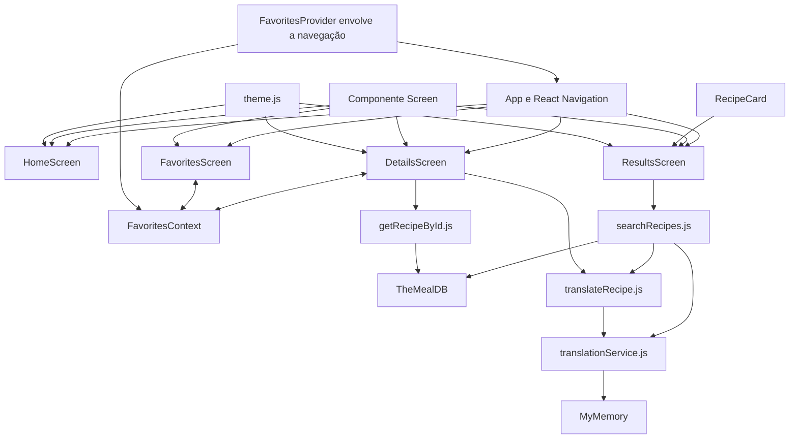
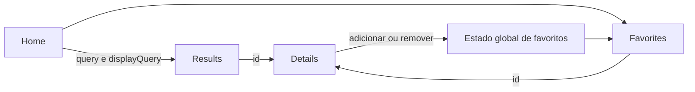

# FoodUMJ

Aplicativo mobile para pesquisar receitas, consultar ingredientes e modo de preparo e organizar favoritos durante a sessão.


Projeto acadêmico da disciplina de **Programação em Dispositivos Móveis**, desenvolvido por quatro integrantes com React Native, Expo, React Navigation e APIs REST.

## Sumário

- [Sobre o projeto](#sobre-o-projeto)
- [Funcionalidades implementadas](#funcionalidades-implementadas)
- [Tecnologias utilizadas](#tecnologias-utilizadas)
- [Arquitetura da aplicação](#arquitetura-da-aplicação)
- [Estrutura de diretórios](#estrutura-de-diretórios)
- [Telas e navegação](#telas-e-navegação)
- [Integração com APIs externas](#integração-com-apis-externas)
- [Gerenciamento de estados](#gerenciamento-de-estados)
- [Instalação e execução](#instalação-e-execução)
- [Tratamento de erros e resiliência](#tratamento-de-erros-e-resiliência)
- [Requisitos acadêmicos](#requisitos-acadêmicos)
- [Testes e validação](#testes-e-validação)
- [Equipe e contribuições](#equipe-e-contribuições)
- [Limitações e evolução](#limitações-e-evolução)

## Sobre o projeto

O FoodUMJ reúne pesquisa, leitura de receitas e favoritos em um fluxo mobile. O usuário pode buscar um prato, consultar suas informações e guardar um resumo para acessá-lo novamente enquanto o aplicativo estiver aberto.

A TheMealDB fornece as receitas. Uma integração com a MyMemory procura apresentar o conteúdo em português brasileiro, preservando o original nos trechos em que a tradução falha. A interface utiliza pt-BR fixo.

O desenvolvimento exercita componentes funcionais, hooks, consumo e normalização de APIs REST, navegação com parâmetros e estado compartilhado com Context API. A organização do código e o histórico de contribuições permitem acompanhar como as partes da equipe se conectam.

## Funcionalidades implementadas

### Requisitos centrais da entrega

- Tela inicial com campo de pesquisa, validação de entrada vazia e acesso aos favoritos.
- Listagem de receitas por nome, com título e imagem.
- Consulta de detalhes pelo ID original da TheMealDB.
- Detalhes roláveis com nome, imagem, ingredientes, medidas e instruções.
- Coração funcional para adicionar e remover favoritos.
- Lista compartilhada de favoritos com abertura dos detalhes e remoção de itens.
- Estados de carregamento, ausência de dados e erro, com nova tentativa na busca e nos detalhes.
- Navegação entre as quatro telas.

### Recursos complementares

- Sugestões de pesquisa para frango, macarrão e sopa.
- Mapeamento de termos comuns em português e tradução de outros termos para pesquisar no catálogo.
- Tradução de títulos, ingredientes, medidas e instruções para pt-BR.
- Cache compartilhado de traduções e reaproveitamento de consultas simultâneas equivalentes.
- Avisos de tradução parcial ou indisponível, preservando os trechos aproveitáveis.
- Recursos básicos de acessibilidade, incluindo rótulos de busca, botões e imagens, cabeçalhos e anúncios de mensagens em partes da interface.
- Área segura e placeholder de imagem na tela de detalhes.

O coração reflete o contexto global. A lista de favoritos dura durante a sessão e é reiniciada quando o provider é recriado.

## Tecnologias utilizadas

As faixas declaradas vêm de [package.json](package.json). As versões reproduzidas por `npm ci` vêm de [package-lock.json](package-lock.json).

| Tecnologia | Versão declarada → versão no lockfile | Finalidade no projeto |
|---|---|---|
| React Native | `0.88.1` → `0.88.1` | Componentes e interface mobile |
| React | `19.3.0` → `19.3.0` | Componentes funcionais, hooks e Context API |
| Expo | `~58.0.23` → `58.0.23` | Ferramentas de desenvolvimento, Metro e execução no Expo Go |
| React Navigation Native | `^7.0.0` → `7.5.1` | Container e estado de navegação |
| React Navigation Native Stack | `^7.0.0` → `7.21.0` | Pilha das quatro rotas |
| React Native Safe Area Context | `~5.11.1` → `5.11.1` | Área segura do componente `Screen` |
| React Native Screens | `~4.30.1` → `4.30.1` | Suporte nativo da navegação em pilha |
| Expo Status Bar | `~58.0.4` → `58.0.4` | Aparência da barra de status |
| JavaScript e Fetch API | Linguagem e API de rede do ambiente | Lógica, consultas HTTP e transformação dos dados |
| TheMealDB | API REST v1 | Catálogo de receitas, imagens e detalhes |
| MyMemory | Endpoint REST `get` | Tradução automática de textos |

A versão da aplicação em [app.json](app.json) e `package.json` é `0.1.0`. A configuração visual usa orientação retrato e tema claro.

## Arquitetura da aplicação

A aplicação organiza a apresentação em telas e componentes, e o acesso HTTP em serviços. [App.js](App.js) registra as rotas dentro de `NavigationContainer` e envolve essa estrutura com `FavoritesProvider`.

- **Apresentação** — as telas gerenciam interação, estados de consulta e renderização.
- **Componentes compartilhados** — `Screen` aplica área segura e espaçamento. `RecipeCard` apresenta os resultados. `theme.js` centraliza as cores utilizadas pela maior parte da interface.
- **Serviços** — `searchRecipes` pesquisa e normaliza resumos. `getRecipeById` consulta e normaliza detalhes.
- **Tradução** — `translateRecipe` prepara textos e protege valores culinários. `translationService` centraliza HTTP, cache, concorrência e tratamento de limites.
- **Estado global** — `FavoritesContext` mantém os resumos favoritos para detalhes e lista.
- **Idioma** — `recipeLocale.js` reúne mensagens e define `RECIPE_LANGUAGE = 'pt-BR'`. Existem mensagens auxiliares em inglês e francês, mas o fluxo atual usa pt-BR fixo.



## Estrutura de diretórios

```text
FoodUMJ/
├── App.js
├── app.json
├── index.js
├── package.json
├── package-lock.json
├── README.md
└── src/
    ├── components/
    │   ├── RecipeCard.js
    │   └── Screen.js
    ├── context/
    │   └── FavoritesContext.js
    ├── i18n/
    │   └── recipeLocale.js
    ├── screens/
    │   ├── HomeScreen.js
    │   ├── ResultsScreen.js
    │   ├── DetailsScreen.js
    │   └── FavoritesScreen.js
    ├── services/
    │   ├── searchRecipes.js
    │   ├── getRecipeById.js
    │   ├── translateRecipe.js
    │   └── translationService.js
    └── theme.js
```

[index.js](index.js) registra o componente principal no Expo. [app.json](app.json) contém nome, versão e configuração visual. O lockfile fixa a árvore de dependências para instalações reproduzíveis. As responsabilidades de `src` estão detalhadas nas seções de arquitetura, telas e APIs.

## Telas e navegação

| Tela | Responsabilidade e integração | Entrada | Estado principal |
|---|---|---|---|
| [HomeScreen](src/screens/HomeScreen.js) | Pesquisa pelo botão, teclado ou sugestões. Abre resultados e favoritos | Sem parâmetros obrigatórios | Texto de busca e validação |
| [ResultsScreen](src/screens/ResultsScreen.js) | Consulta por nome e exibe `RecipeCard` em `FlatList`. Abre `Details` com o ID selecionado | `route.params.query` e `displayQuery` opcional, com fallback para `query` | Receitas, carregamento e erro |
| [DetailsScreen](src/screens/DetailsScreen.js) | Consulta o ID, traduz o conteúdo, exibe imagem e informações completas e alterna favoritos | `route.params.id` como string de dígitos | Receita, carregamento, erro, tentativa, tradução e falha de imagem |
| [FavoritesScreen](src/screens/FavoritesScreen.js) | Exibe resumos salvos, abre detalhes e remove itens da lista | Sem parâmetros obrigatórios | Favoritos compartilhados pelo contexto |

O contrato de resultados é `{ id, name, imageUrl }`. O detalhe acrescenta `ingredients` e `instructions`. O ID permanece o mesmo fornecido pela TheMealDB.



O retorno entre telas usa a pilha do React Navigation. Para consultar favoritos a partir dos detalhes, volte à tela inicial e toque em **Ver favoritas**. O repositório não contém capturas de tela versionadas.

## Integração com APIs externas

### TheMealDB

A aplicação usa requisições `GET` à API v1, com a chave pública de teste `1` para uso educacional.

| Operação | Endpoint utilizado | Parâmetro | Saída do serviço local |
|---|---|---|---|
| Pesquisa por nome | `https://www.themealdb.com/api/json/v1/1/search.php` | `s` com o termo codificado | Lista de resumos |
| Consulta por ID | `https://www.themealdb.com/api/json/v1/1/lookup.php` | `i` com o ID codificado | Detalhe normalizado ou `null` |

A pesquisa usa o endpoint de nome, inclusive quando o usuário digita um alimento como frango. A resposta contém `meals` com objetos que incluem `idMeal`, `strMeal` e `strMealThumb`. `meals: null` indica ausência de resultados.

Em [searchRecipes.js](src/services/searchRecipes.js), o termo passa por um dicionário de português para inglês ou pela MyMemory. Após a consulta, os títulos passam pela tradução e o serviço produz resumos.

Em [getRecipeById.js](src/services/getRecipeById.js), o serviço valida o ID, exige uma receita com ID correspondente e confere nome e URL de imagem preenchidos. Ingredientes e medidas são associados pelos índices de 1 a 20. Cada par mantém sua medida correspondente, e nomes vazios são descartados. Campos de ingrediente, medida e instruções são tratados como texto e aparados nas bordas.

```javascript
// Retorno adaptado de getRecipeById.js após validar a resposta.
return {
  id: meal.idMeal,
  name: meal.strMeal,
  imageUrl: meal.strMealThumb,
  ingredients, // Lista de { name, measure } associada pelos índices da API.
  instructions: trimText(meal.strInstructions),
};
```

As telas recebem esses objetos normalizados. A tradução preserva ID e URL da imagem e cria uma representação textual para exibição. Respostas HTTP sem sucesso, JSON inválido ou estruturas incompatíveis são encaminhados ao tratamento de erro. A busca verifica se `meals` é uma lista, mas tem validação dos campos de cada item menos rigorosa que a consulta por ID.

O catálogo e as imagens dependem da disponibilidade externa e da conexão. A chave `1` é destinada ao desenvolvimento e uso educacional. Uma distribuição em lojas exige observar as condições do serviço. [Documentação da TheMealDB](https://www.themealdb.com/api.php)

### MyMemory e tradução

| Item | Comportamento implementado |
|---|---|
| Endpoint e método | `GET https://api.mymemory.translated.net/get` |
| Parâmetros | `q` com o segmento e `langpair` com o par de idiomas, ambos codificados |
| Pares do fluxo atual | `pt-BR\|en` para termos de pesquisa e `en\|pt-BR` para receitas |
| Resposta | `responseStatus`, `responseData.translatedText`, `matches` e sinais de cota |
| Resultado interno | Texto aproveitável ou fallback para o trecho original |

A configuração atual faz consultas sem identificação pessoal no parâmetro `de` e sem chave privada.

[translateRecipe.js](src/services/translateRecipe.js) separa textos longos, preserva quebras de linha e prepara nomes, ingredientes, medidas e instruções. Quantidades, frações, temperaturas e tempos recebem marcadores antes da tradução. Unidades conhecidas têm equivalências locais, e os valores protegidos são restaurados depois da validação.

[translationService.js](src/services/translationService.js) aplica estas regras.

- Segmentos com até 500 bytes UTF-8, agrupando textos curtos dentro desse limite.
- Até três requisições simultâneas, com timeout de 6,5 segundos por chamada e prazo de 35 segundos por operação de tradução de segmentos.
- Cache em memória de até 400 entradas. A chave considera par de idiomas, texto original e consulta preparada.
- Compartilhamento de requisições em andamento para a mesma chave, inclusive entre títulos da busca e detalhes.
- Validação de marcadores e valores numéricos e decodificação de entidades HTML.
- Pausa compartilhada diante de HTTP 429 ou indicação de cota esgotada. Usa `Retry-After` quando válido ou 60 segundos como espera padrão.
- Fallback por trecho para avisos de tamanho ou traduções inválidas. Falhas de rede e timeout encerram novas consultas daquele contexto e preservam conteúdo disponível.

Os resultados válidos entram no cache. O cache e a pausa de cota são reiniciados com o processo JavaScript. A tradução usa um serviço externo e pode ser lenta, incompleta ou imprecisa. [Especificação da MyMemory](https://mymemory.translated.net/doc/spec.php) e [limites de uso](https://mymemory.translated.net/doc/usagelimits.php)

`translateRecipe` retorna `{ recipe, usedOriginal }`. Nos detalhes, `usedOriginal` sinaliza fallback em pelo menos um trecho. A tela compara o conteúdo para distinguir tradução parcial de indisponibilidade total e apresenta o aviso correspondente.

## Gerenciamento de estados

`useState` controla a entrada e a validação na Home, a lista e os estados de consulta nos resultados e os dados e tentativas nos detalhes. O estado de tradução é separado do carregamento da receita.

`useEffect` inicia a busca quando `query` muda e a consulta dos detalhes quando o ID ou a tentativa muda. Nos detalhes, a troca de ID recria `RecipeDetails` pela chave, e o cleanup impede respostas antigas de atualizar a tela. A tradução também verifica um `AbortController` antes de atualizar o estado. A busca em `ResultsScreen` ainda tem a limitação de concorrência descrita ao final.

[createContext e useContext](src/context/FavoritesContext.js) compartilham os favoritos entre telas. O provider usa `useState([])` e envolve a navegação.

```jsx
// Estrutura adaptada de App.js.
<FavoritesProvider>
  <NavigationContainer theme={theme}>
    <StatusBar style="dark" />
    <Stack.Navigator>{/* As quatro rotas */}</Stack.Navigator>
  </NavigationContainer>
</FavoritesProvider>
```

| Função | Responsabilidade |
|---|---|
| `useFavorites()` | Retorna `favorites`, `isFavorite` e `toggleFavorite` do contexto |
| `isFavorite(id)` | Verifica se a lista contém uma receita com o mesmo ID |
| `toggleFavorite(recipe)` | Remove um ID existente ou adiciona `{ id, name, imageUrl }` com atualização funcional do estado |

```jsx
// Exemplo adaptado da integração em DetailsScreen.js.
const { isFavorite, toggleFavorite } = useFavorites();
const isFav = isFavorite(recipe.id);

<Pressable
  accessibilityRole="button"
  accessibilityLabel={isFav ? 'Remover dos favoritos' : 'Adicionar aos favoritos'}
  onPress={() => toggleFavorite({
    id: recipe.id,
    name: displayRecipe.name,
    imageUrl,
  })}
>
  <Text>{isFav ? '♥' : '♡'}</Text>
</Pressable>
```

O nome salvo é o exibido no momento da ação. Ingredientes e preparo são consultados novamente quando o usuário reabre a receita pelo ID. Os favoritos ficam disponíveis enquanto o provider permanecer montado. Encerrar o processo ou recarregar a aplicação reinicia a lista, pois não há armazenamento persistente implementado.

## Instalação e execução

### Pré-requisitos

- Git e npm.
- Node.js 24 LTS, na versão 24.3.0 ou superior da série 24, compatível com a versão de React Native fixada no lockfile.
- Expo Go compatível com **SDK 58** no dispositivo.
- Computador e dispositivo com conectividade entre si na rede local e acesso à internet para as APIs.

O projeto não fixa Node.js em `engines` ou arquivo de versão. A recomendação acima também corresponde ao ambiente usado nas verificações locais. Confirme a compatibilidade do Expo Go com o SDK do projeto antes de abrir o QR Code. [Orientações do Expo](https://docs.expo.dev/get-started/start-developing/)

### Instalar e iniciar

```bash
git clone --branch main https://github.com/CarlosAoves/FoodUMJ.git
cd FoodUMJ
npm ci
npm start
```

`npm ci` instala a árvore do lockfile. Os scripts disponíveis são `start`, `android` e `ios`. Não há script `test` ou `web` configurado.

Para selecionar explicitamente LAN, Expo Go e uma porta livre, execute o comando abaixo.

```bash
npx expo start --lan --go --port 8081
```

Se a porta estiver ocupada, use outra, como `8082`. O computador deve aceitar conexões locais na porta escolhida. O QR Code deve ser o da sessão atual do servidor.

### Android e iOS

No Android, abra o Expo Go e use a opção de ler o QR Code exibido pelo terminal. Em um emulador Android configurado, `npm run android` inicia o Expo para Android.

No iPhone, escaneie o QR Code com a Câmera e abra o projeto no Expo Go. Siga eventuais exigências de autenticação do Expo Go. A documentação atual do Expo orienta usar a mesma conta no Expo CLI e no Expo Go em dispositivos iOS físicos. Para o simulador iOS, `npm run ios` exige macOS e Xcode configurados. [Execução no dispositivo](https://docs.expo.dev/get-started/start-developing/)

Se a conexão falhar, confira a rede, o endereço anunciado pelo Expo, o firewall e eventuais regras do roteador que impeçam comunicação entre dispositivos.

### Verificações de desenvolvimento

```bash
npx expo install --check
npx expo export --platform android --output-dir .expo/validacao-android
git diff --check
```

O primeiro comando consulta a compatibilidade das dependências. O segundo produz um bundle Android para inspeção. A exportação não substitui o teste visual no Expo Go.

## Tratamento de erros e resiliência

| Situação | Comportamento atual |
|---|---|
| Pesquisa vazia ou só com espaços | A Home apresenta uma mensagem e mantém o usuário na tela |
| Busca sem resultados | Results mostra `Nenhuma receita encontrada` |
| ID ausente ou fora do formato esperado | Details evita a consulta e mostra `Receita não encontrada.` |
| ID válido sem receita | O serviço retorna `null` e Details exibe o estado vazio |
| Falha HTTP, de rede ou JSON inconsistente | Busca e detalhes apresentam erro com `Tentar novamente` |
| Ingredientes ou instruções vazios | Details mostra mensagens específicas de indisponibilidade |
| URL de imagem ausente, incompatível ou com falha de carregamento nos detalhes | Details apresenta `Imagem indisponível.` quando a receita chega à renderização. Uma imagem ausente na resposta da API é rejeitada antes, pela validação do serviço |
| Tradução em andamento | Details apresenta `Traduzindo receita...` |
| Tradução parcialmente aproveitada | Mantém os trechos válidos e avisa `Tradução parcial. Alguns trechos estão no idioma original.` |
| Tradução totalmente indisponível | Exibe o conteúdo original e informa a indisponibilidade |
| Cota de tradução esgotada | Evita novas consultas durante a pausa compartilhada e usa o fallback |

O placeholder de imagem está implementado nos detalhes. Os cards de resultados e a lista de favoritos ainda não têm recuperação explícita de erro de imagem.

## Requisitos acadêmicos

A matriz representa evidências na implementação. A validação no dispositivo deve seguir o roteiro da seção seguinte.

| Requisito acadêmico | Implementação correspondente | Arquivo de referência | Status |
|---|---|---|---|
| React Native com Expo | Aplicação, componentes nativos e configuração Expo | [package.json](package.json), [app.json](app.json) | Implementado |
| Consumo de API externa | Pesquisa e consulta na TheMealDB | [searchRecipes.js](src/services/searchRecipes.js), [getRecipeById.js](src/services/getRecipeById.js) | Implementado |
| Uso de `useState` | Entrada, consultas e favoritos | [HomeScreen.js](src/screens/HomeScreen.js), [FavoritesContext.js](src/context/FavoritesContext.js) | Implementado |
| Uso de `useContext` | Compartilhamento dos favoritos | [FavoritesContext.js](src/context/FavoritesContext.js) | Implementado |
| Tela inicial com pesquisa | Campo, validação e sugestões | [HomeScreen.js](src/screens/HomeScreen.js) | Implementado |
| Tela de resultados | Lista com nome, imagem e seleção | [ResultsScreen.js](src/screens/ResultsScreen.js) | Implementado |
| Tela de detalhes | Consulta por ID e conteúdo rolável | [DetailsScreen.js](src/screens/DetailsScreen.js) | Implementado |
| Nome, imagem, ingredientes e preparo | Normalização e apresentação | [getRecipeById.js](src/services/getRecipeById.js), [DetailsScreen.js](src/screens/DetailsScreen.js) | Implementado |
| Tela de favoritos | Lista, estado vazio e abertura dos detalhes | [FavoritesScreen.js](src/screens/FavoritesScreen.js) | Implementado |
| Adicionar e remover favoritos | Alternância por ID nas duas telas | [FavoritesContext.js](src/context/FavoritesContext.js), [DetailsScreen.js](src/screens/DetailsScreen.js) | Implementado |
| Navegação | Rotas Home, Results, Details e Favorites | [App.js](App.js) | Implementado |
| Carregamento e erros | Indicadores e nova tentativa | [ResultsScreen.js](src/screens/ResultsScreen.js), [DetailsScreen.js](src/screens/DetailsScreen.js) | Implementado |
| Repositório público | Código e histórico acessíveis | [Repositório oficial](https://github.com/CarlosAoves/FoodUMJ) | Verificado no GitHub |
| Participação dos quatro integrantes por commits | Autoria e arquivos rastreáveis | [Equipe e contribuições](#equipe-e-contribuições) | Verificado no histórico |

A apresentação presencial e a demonstração individual das contribuições dependem da equipe. O código e o histórico fornecem as evidências técnicas, mas a realização dessa apresentação precisa ser confirmada no contexto da disciplina.

## Testes e validação

O repositório não inclui uma suíte de testes automatizados ou um script `npm test`. As verificações realizadas no ambiente isolado em 18 de novembro de 2026 incluíram instalação por `npm ci`, sintaxe de 15 arquivos JavaScript, resolução de 44 imports, bundle Android e cenários com mocks para busca, detalhes, tradução e sincronização de favoritos. Esses mocks foram executados externamente à árvore versionada.

O Expo Go foi disponibilizado para teste manual. A execução dos fluxos completos no dispositivo e a aprovação visual da versão integrada precisam ser confirmadas pela equipe.

### Roteiro manual

| Cenário | Procedimento | Resultado esperado |
|---|---|---|
| Pesquisa válida | Pesquisar `frango` ou tocar em Frango | Carregamento e lista de receitas quando a API responder |
| Entrada vazia | Pesquisar com campo vazio ou só espaços | Mensagem de validação na Home |
| Sem correspondência | Pesquisar um termo inexistente | Estado vazio nos resultados |
| Abrir detalhes | Selecionar uma receita da lista | Nome, imagem, ingredientes, medidas e preparo correspondentes ao ID |
| Conteúdo extenso | Abrir uma receita com nome e preparo longos | Quebra de linhas e rolagem até o final |
| Adicionar favorito | Tocar no coração vazio | Coração preenchido e um resumo salvo na lista |
| Reabrir favorito | Voltar à Home, abrir favoritas e selecionar o item | Consulta dos detalhes pelo mesmo ID e coração preenchido |
| Remover nos detalhes | Tocar no coração preenchido | Coração vazio e item removido da lista |
| Remover na lista | Remover um item e reabrir seus detalhes pelos resultados | Item ausente e coração vazio |
| Duas receitas | Alternar entre duas receitas e favoritar ambas | Estados independentes por ID e lista coerente |
| Falha de conexão | Desconectar a rede antes de uma nova consulta | Mensagem de erro ao falhar a requisição |
| Recuperação | Reconectar e tocar em Tentar novamente | Nova consulta e exibição do conteúdo quando disponível |
| Tradução indisponível | Em ambiente de teste, observar falha, timeout ou cota do tradutor | Conteúdo original nos trechos afetados e aviso nos detalhes |
| Reinício | Salvar um favorito e recarregar a aplicação | Lista reiniciada, conforme o armazenamento em memória |

Para validar tradução indisponível com precisão, use mocks em um ambiente de teste. Desligar a internet também impede a consulta à TheMealDB, e traduções já em cache podem dispensar chamadas externas.

## Equipe e contribuições

A atribuição abaixo foi conferida pela autoria associada no GitHub, pelos arquivos alterados e pelos PRs integrados. Os nomes apresentados são os identificadores públicos dos integrantes.

| Integrante | Perfil GitHub | Responsabilidades | Evidências de contribuição |
|---|---|---|---|
| CarlosAoves | [CarlosAoves](https://github.com/CarlosAoves) | Base do projeto, Home, navegação, componente Screen e tema inicial | [9a8e366](https://github.com/CarlosAoves/FoodUMJ/commit/9a8e366), com a estrutura inicial |
| eitor2006-svg | [eitor2006-svg](https://github.com/eitor2006-svg) | Integração da busca, resultados, RecipeCard e primeira infraestrutura de tradução de termos e títulos | [70a5d9d](https://github.com/CarlosAoves/FoodUMJ/commit/70a5d9d), [6745eb5](https://github.com/CarlosAoves/FoodUMJ/commit/6745eb5) e [PR #1](https://github.com/CarlosAoves/FoodUMJ/pull/1) |
| Maycon2222 | [Maycon2222](https://github.com/Maycon2222) | Consulta por ID, normalização dos detalhes, imagem, ingredientes, preparo, consolidação da tradução e botão visual inicial de favoritos | [d9363db](https://github.com/CarlosAoves/FoodUMJ/commit/d9363db), [bb1f41b](https://github.com/CarlosAoves/FoodUMJ/commit/bb1f41b), [192c7c0](https://github.com/CarlosAoves/FoodUMJ/commit/192c7c0), [009fe39](https://github.com/CarlosAoves/FoodUMJ/commit/009fe39), [7a94d0a](https://github.com/CarlosAoves/FoodUMJ/commit/7a94d0a) e [PR #2](https://github.com/CarlosAoves/FoodUMJ/pull/2) |
| henrdev | [henrdev](https://github.com/henrdev) | Contexto e hook de favoritos, lista, inclusão do provider na navegação e conexão funcional do coração | [b47f175](https://github.com/CarlosAoves/FoodUMJ/commit/b47f175), [0fb9fc9](https://github.com/CarlosAoves/FoodUMJ/commit/0fb9fc9), [c448d9b](https://github.com/CarlosAoves/FoodUMJ/commit/c448d9b), [f7e6034](https://github.com/CarlosAoves/FoodUMJ/commit/f7e6034) e [PR #3](https://github.com/CarlosAoves/FoodUMJ/pull/3) |

A tradução compartilhada combina a infraestrutura inicial de eitor2006-svg com a consolidação realizada por Maycon2222. O botão visual de detalhes foi posteriormente conectado ao contexto por henrdev. Os PRs documentam a integração das contribuições da equipe.

## Limitações e evolução

### Limitações atuais

- **Favoritos e cache voláteis** — ambos são mantidos em memória. Uma nova sessão começa sem os dados anteriores.
- **Dependência externa** — receitas, imagens e traduções dependem da rede e da disponibilidade dos serviços.
- **Tradução aproximada** — disponibilidade, cota e qualidade variam. Um prato pode aparecer com trechos no idioma original, e a tradução não garante precisão culinária.
- **Consultas de receitas** — busca e consulta por ID não definem timeout próprio. Os timeouts explícitos estão na infraestrutura de tradução.
- **Concorrência nos resultados** — `ResultsScreen` não invalida respostas de consultas anteriores. Se `query` mudar durante uma consulta, uma resposta antiga pode substituir a lista atual. O comportamento foi reproduzido com mocks na validação isolada.
- **Validação da busca** — itens retornados pela pesquisa não passam pelas mesmas verificações detalhadas aplicadas na consulta por ID.
- **Imagens e acessibilidade** — resultados e favoritos não tratam explicitamente falhas de imagem. A tela de favoritos pode receber rótulos e papéis mais específicos para leitores de tela. O coração usa um rótulo dinâmico, mas não declara `accessibilityState.selected`.
- **Compatibilidade de versões** — a verificação online do Expo realizada em 18 de novembro de 2026 recomendou `expo ~58.0.26` e `expo-status-bar ~58.0.5` para a instalação analisada. O lockfile mantém as versões da tabela. Execute `npx expo install --check` ao preparar o ambiente e avalie os avisos antes de qualquer atualização.
- **Validação automatizada** — os cenários com mocks ainda não constituem uma suíte versionada e reproduzível pelo repositório.

### Possibilidades de evolução

Persistência local dos favoritos, testes automatizados versionados, proteção de respostas antigas na busca, melhoria dos estados de imagem e ampliação da acessibilidade são caminhos de evolução. Esses itens complementam os requisitos acadêmicos implementados e devem ser planejados pela equipe.
